# 实际使用的资产生成提示词

本次使用内置图片生成工具。人物采用写实古装影片质感；每张人物图左35%为上半身特写，右65%为正、侧、背三个全身视图。六个人物身份只各生成一张。黑白猫另为动物四视设定。

## C01 黑衣剑客

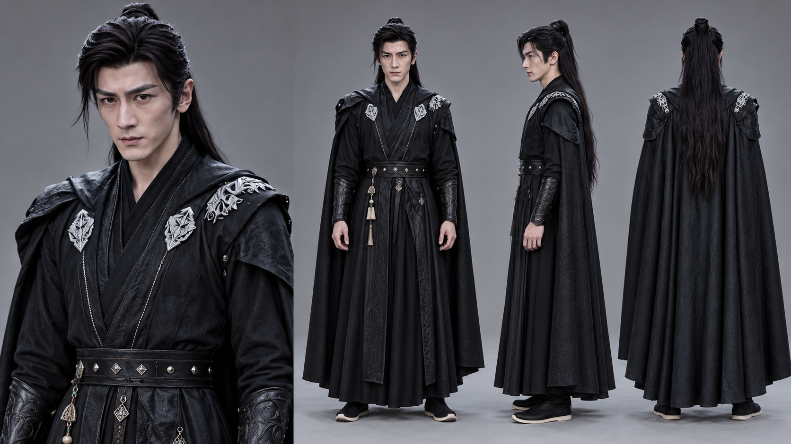

尺寸：1672×941像素，16:9整数像素近似。

Use case: identity-preserve. Create one photorealistic Chinese historical fantasy film CHARACTER DESIGN SHEET using supplied reference identity and costume. 16:9 landscape. LEFT 35%: one large UPPER BODY portrait, complete head down to waist. RIGHT 65%: three full body neutral standing views of exactly same person, FRONT, true 90-degree SIDE, BACK. Same scale and outfit, feet fully in frame, hands relaxed. Neutral grey seamless studio, soft light, realistic skin and cloth, no text, no captions, no watermark, no other people. Match reference face and wardrobe, do not turn it into cartoon or 3D game art. Fully clothed. Young adult Chinese male, sharp clean-shaven angular face, thick straight brows, dark eyes, long black hair half tied in high knot, remaining hair falling down back and loose strand at temple. Black layered martial robe with silver embroidered floral/rosette ornaments at lapels and shoulders, dark leather shoulder panels and bracers, riveted leather waist belt, long black cape, black boots with pale soles. Neutral expression. No sword held in hands; preserve hip pendants.

## C02 小女孩

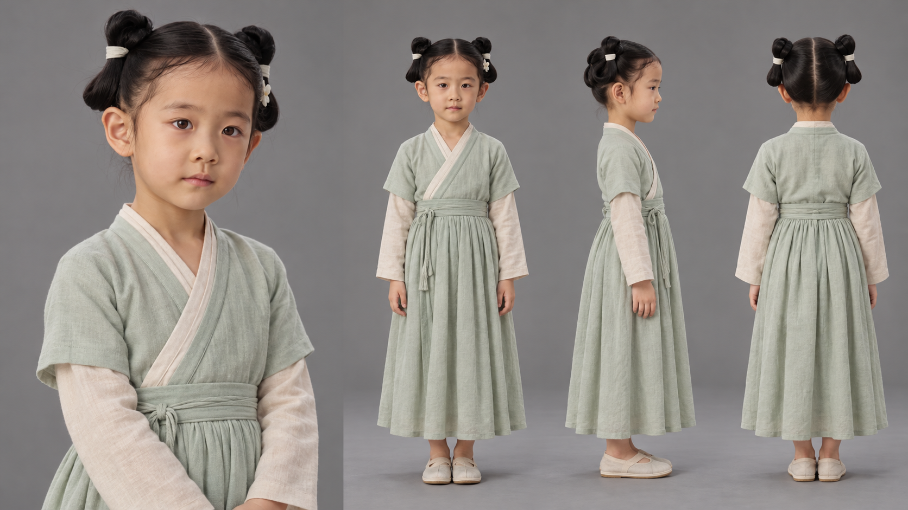

尺寸：1672×941像素，16:9整数像素近似。

Use case: identity-preserve. Create one photorealistic Chinese historical fantasy film CHARACTER DESIGN SHEET using supplied reference identity and costume. 16:9 landscape. LEFT 35%: one large UPPER BODY portrait, complete head down to waist. RIGHT 65%: three full body neutral standing views of exactly same person, FRONT, true 90-degree SIDE, BACK. Same scale and outfit, feet fully in frame, hands relaxed. Neutral grey seamless studio, soft light, realistic skin and cloth, no text, no captions, no watermark, no other people. Match reference face and wardrobe, do not turn it into cartoon or 3D game art. Fully clothed. A Chinese little girl about 6 to 8 years old, keep her clearly CHILD age and proportions, round small face, brown eyes, middle parted black hair in two side double buns tied with ivory ribbons, small white flower clip. Simple fully covering pale sage green cross-collar dress over ivory long-sleeve undershirt, calf to ankle length softly gathered skirt, plain light cloth shoes. Innocent neutral expression. No cat in sheet, no adult or other person, no glamor makeup.

## C03 母亲

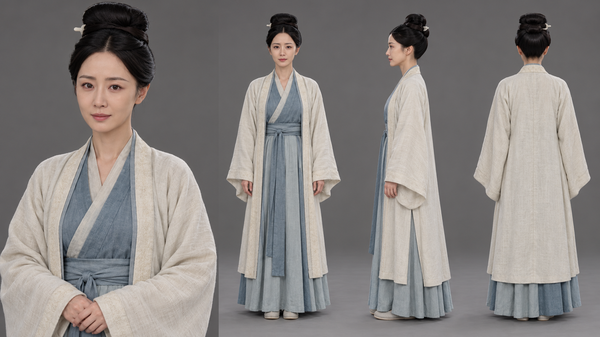

尺寸：1672×941像素，16:9整数像素近似。

Use case: identity-preserve. Create one photorealistic Chinese historical fantasy film CHARACTER DESIGN SHEET using supplied reference identity and costume. 16:9 landscape. LEFT 35%: one large UPPER BODY portrait, complete head down to waist. RIGHT 65%: three full body neutral standing views of exactly same person, FRONT, true 90-degree SIDE, BACK. Same scale and outfit, feet fully in frame, hands relaxed. Neutral grey seamless studio, soft light, realistic skin and cloth, no text, no captions, no watermark, no other people. Match reference face and wardrobe, do not turn it into cartoon or 3D game art. Fully clothed. Adult Chinese woman in her thirties, oval face, fine gently arched brows, dark eyes, black hair center parted and tied into high rounded piled bun, simple hairpin. Ivory light beige wide sleeved outer robe, muted blue-grey inner cross-collar robe and floor length skirt, fabric waist sash, pale cloth shoes. Match reference modest everyday outfit. Calm neutral portrait, no crying, no child, no cat.

## C04 白面客

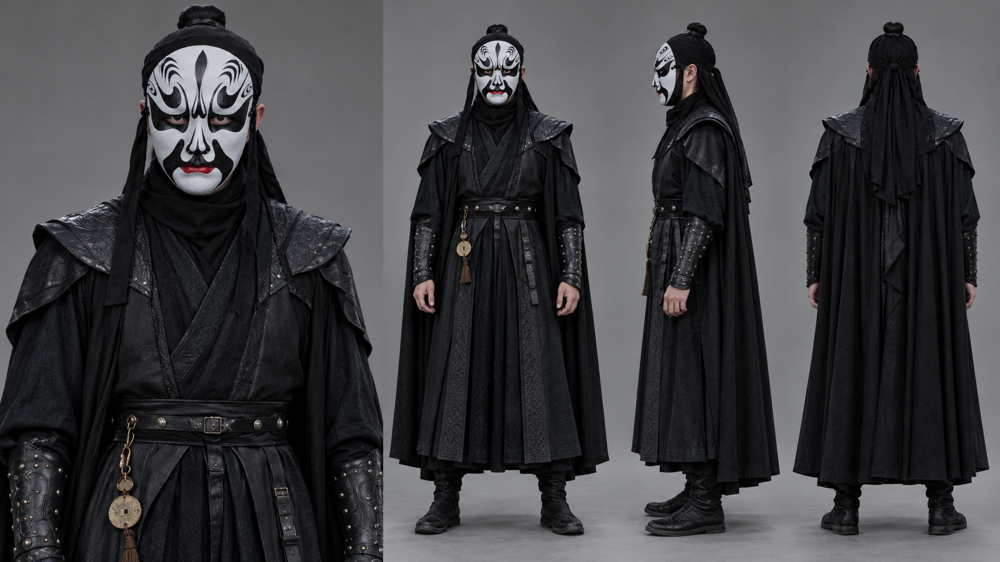

尺寸：1672×941像素，16:9整数像素近似。

Use case: identity-preserve. Create one photorealistic Chinese historical fantasy film CHARACTER DESIGN SHEET using supplied reference identity and costume. 16:9 landscape. LEFT 35%: one large UPPER BODY portrait, complete head down to waist. RIGHT 65%: three full body neutral standing views of exactly same person, FRONT, true 90-degree SIDE, BACK. Same scale and outfit, feet fully in frame, hands relaxed. Neutral grey seamless studio, soft light, realistic skin and cloth, no text, no captions, no watermark, no other people. Match reference face and wardrobe, do not turn it into cartoon or 3D game art. Fully clothed. Adult male masked martial intruder. His FACE MUST ALWAYS BE COVERED by exact WHITE opera mask with black flame/curl eyebrows, broad black eye fields and moustache-like curves, red lips, chin white. Mask is rigid physical mask with eye holes, preserve eye visibility, do not invent or show unmasked face. Black head wrap with long black hair at back, black scarf, black layered long martial robe, dark leather shoulder armor, long cape, riveted bracers and waist belt, black boots. Stand relaxed, no weapon raised.

## C05 蓝面客

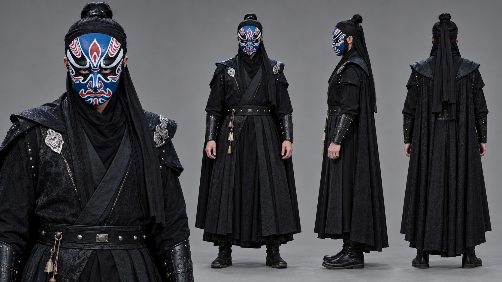

尺寸：1672×941像素，16:9整数像素近似。

Use case: identity-preserve. Create one photorealistic Chinese historical fantasy film CHARACTER DESIGN SHEET using supplied reference identity and costume. 16:9 landscape. LEFT 35%: one large UPPER BODY portrait, complete head down to waist. RIGHT 65%: three full body neutral standing views of exactly same person, FRONT, true 90-degree SIDE, BACK. Same scale and outfit, feet fully in frame, hands relaxed. Neutral grey seamless studio, soft light, realistic skin and cloth, no text, no captions, no watermark, no other people. Match reference face and wardrobe, do not turn it into cartoon or 3D game art. Fully clothed. Adult male masked martial intruder. Always wear exact deep BLUE opera mask in reference1, white curling outlines around eyes and cheeks, red teardrop forehead emblem, black eye fields, red and white moustache-like lines around mouth and nose. Exact complex mask, never show imagined bare face. Black topknot and headwrap, long hair, black layered martial robe, dark shoulder pads, black cape, leather riveted bracers, belt and boots. Use center person in reference2 for wardrobe; ignore the two companions. No sword held.

## C06 红面客

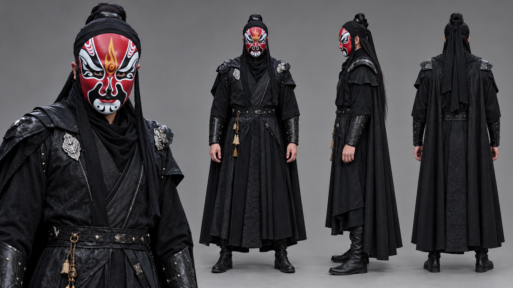

尺寸：1672×941像素，16:9整数像素近似。

Use case: identity-preserve. Create one photorealistic Chinese historical fantasy film CHARACTER DESIGN SHEET using supplied reference identity and costume. 16:9 landscape. LEFT 35%: one large UPPER BODY portrait, complete head down to waist. RIGHT 65%: three full body neutral standing views of exactly same person, FRONT, true 90-degree SIDE, BACK. Same scale and outfit, feet fully in frame, hands relaxed. Neutral grey seamless studio, soft light, realistic skin and cloth, no text, no captions, no watermark, no other people. Match reference face and wardrobe, do not turn it into cartoon or 3D game art. Fully clothed. Adult male masked martial intruder. Always wear exact RED opera mask in reference1, gold flame ornament down forehead, black eye fields with white curves, white chin with black comma motifs, black nose, red lips. Never show imagined unmasked face. Black headwrap/topknot, long hair, layered black martial robe, leather shoulder armor, cape, leather bracers and belt, black boots. Use RIGHT person in reference2 for wardrobe, ignore companions. No sword held.

## A01 黑白猫

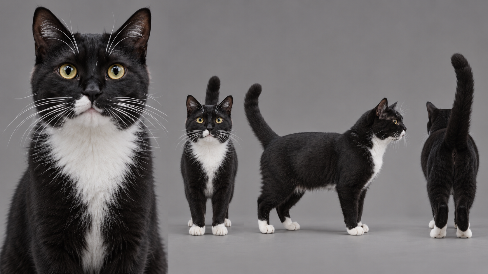

尺寸：1672×941像素，16:9整数像素近似。

Use case: identity-preserve. Create one photorealistic Chinese historical fantasy film CHARACTER DESIGN SHEET using supplied reference identity and costume. 16:9 landscape. LEFT 35%: one large UPPER BODY portrait, complete head down to waist. RIGHT 65%: three full body neutral standing views of exactly same person, FRONT, true 90-degree SIDE, BACK. Same scale and outfit, feet fully in frame, hands relaxed. Neutral grey seamless studio, soft light, realistic skin and cloth, no text, no captions, no watermark, no other people. Match reference face and wardrobe, do not turn it into cartoon or 3D game art. Fully clothed. This sheet is a realistic ANIMAL, not a human. One adult short-haired tuxedo domestic cat, black coat, white chest bib, white muzzle marks and four white paws, golden yellow-green eyes, white whiskers. LEFT large head-and-upper-chest portrait; RIGHT three complete neutral standing quadruped views FRONT, 90-degree SIDE, BACK, same cat fur markings and body size, all paws and tail in frame. No clothes or accessories, no anthropomorphism, no person. Preserve asymmetric natural muzzle markings, realistic fur.

## S01 雾山荒径

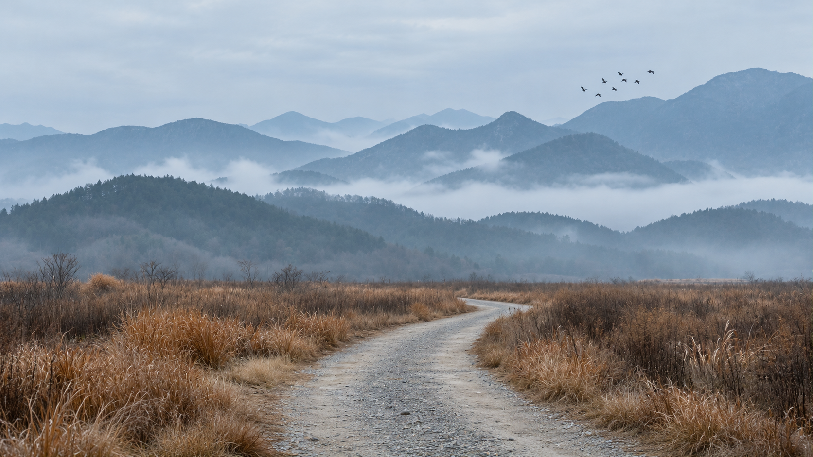

尺寸：1672×941像素，16:9整数像素近似。

Use case: historical-scene. Generate one photorealistic cinematic ancient Chinese fantasy film environment asset, landscape 16:9, matching the supplied video frame's architecture, lighting, colors and textures. Clean EMPTY set with no humans or animals, no captions, no watermarks. Preserve material and composition cues, useful wide view with usable floor/ground. Winding pale gravel path through tawny dry grass with blue-grey misty mountain layers. Overcast pale sky. Retain small distant flock as environment element.

## S02 雨镇街巷

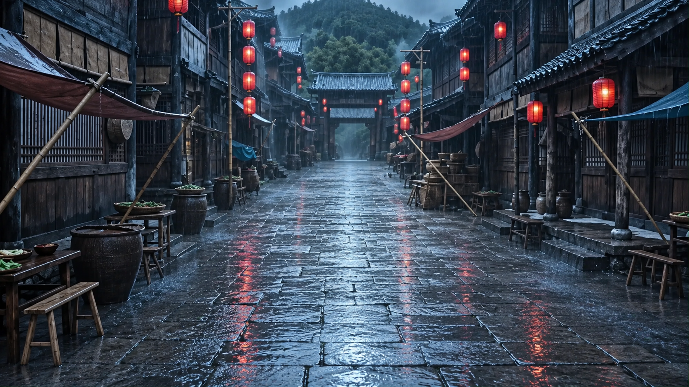

尺寸：1672×941像素，16:9整数像素近似。

Use case: historical-scene. Generate one photorealistic cinematic ancient Chinese fantasy film environment asset, landscape 16:9, matching the supplied video frame's architecture, lighting, colors and textures. Clean EMPTY set with no humans or animals, no captions, no watermarks. Preserve material and composition cues, useful wide view with usable floor/ground. Remove all three masked men. Empty wet stone street, old dark timber shopfronts and white walls, grey tile roofs, red hanging lanterns, canvas market awnings, baskets, barrels, mountain and gate at far end. Cold blue rain atmosphere, subtle warm lantern accents.

## S03 古玩店内

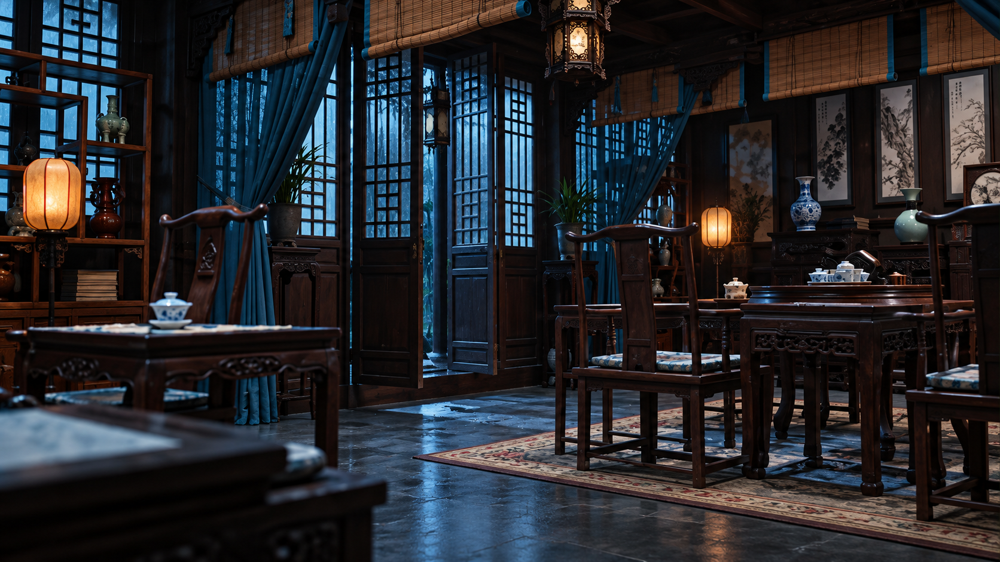

尺寸：1672×941像素，16:9整数像素近似。

Use case: historical-scene. Generate one photorealistic cinematic ancient Chinese fantasy film environment asset, landscape 16:9, matching the supplied video frame's architecture, lighting, colors and textures. Clean EMPTY set with no humans or animals, no captions, no watermarks. Preserve material and composition cues, useful wide view with usable floor/ground. Traditional dark wooden room with lattice windows, blue curtains, bamboo blinds, display shelves of porcelain and books, tea tables and wooden chairs, warm little lanterns against blue rainy window light. No intruders.

## S04 寝居暖室

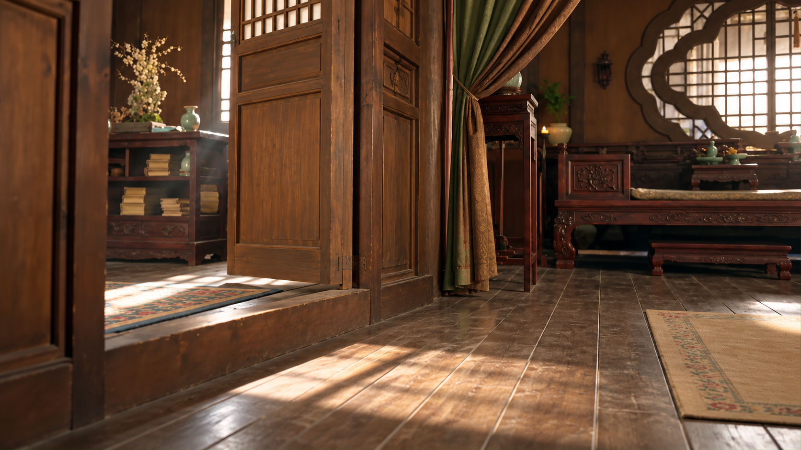

尺寸：1672×941像素，16:9整数像素近似。

Use case: historical-scene. Generate one photorealistic cinematic ancient Chinese fantasy film environment asset, landscape 16:9, matching the supplied video frame's architecture, lighting, colors and textures. Clean EMPTY set with no humans or animals, no captions, no watermarks. Preserve material and composition cues, useful wide view with usable floor/ground. Remove woman, girl and cat. Modest warm wood bedroom with carved reddish wood bed and low bed-side step, patterned bedding, wood partition door, book shelf, circular lattice window, fabric curtains, porcelain vase and branch. Daylight baseline, naturally warm wood, preserve furnishings rather than add luxury.

## S05 室内山水异境

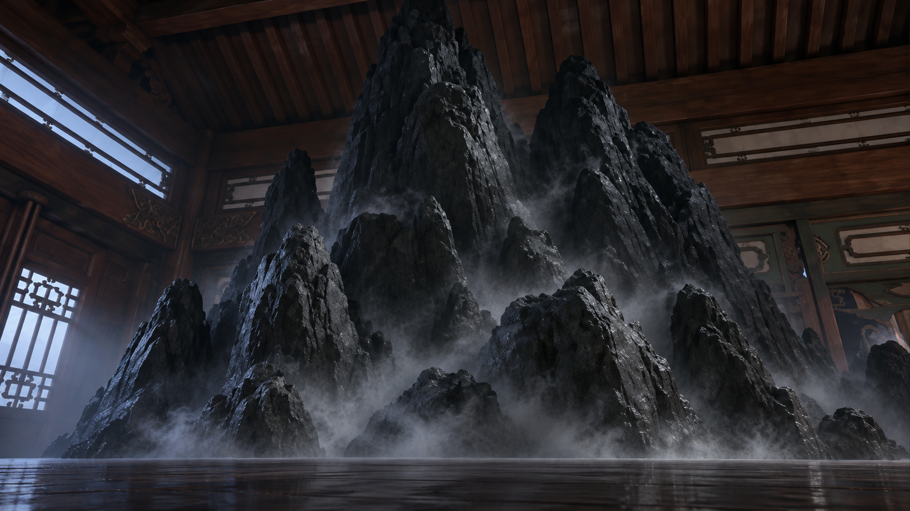

尺寸：1672×941像素，16:9整数像素近似。

Use case: historical-scene. Generate one photorealistic cinematic ancient Chinese fantasy film environment asset, landscape 16:9, matching the supplied video frame's architecture, lighting, colors and textures. Clean EMPTY set with no humans or animals, no captions, no watermarks. Preserve material and composition cues, useful wide view with usable floor/ground. A surreal miniature craggy black-grey mountain massif rising inside a traditional wooden chamber. Retain wood beams, ceiling and lattice window scale cues. Low angle, atmospheric grey mist among peaks. No cat, no people. It is indoor impossible landscape, not ordinary outdoor mountain.

## S06 异境庭院

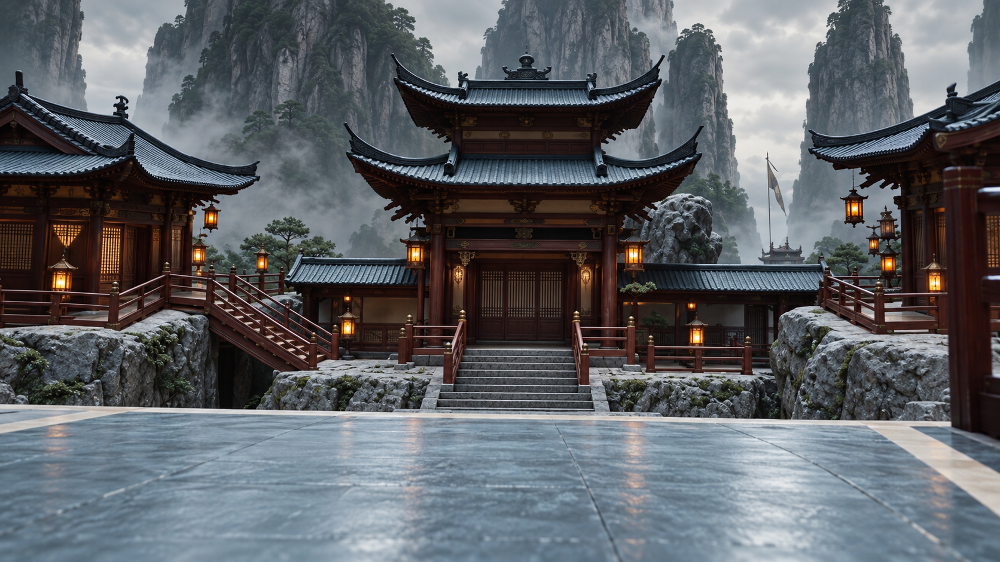

尺寸：1672×941像素，16:9整数像素近似。

Use case: historical-scene. Generate one photorealistic cinematic ancient Chinese fantasy film environment asset, landscape 16:9, matching the supplied video frame's architecture, lighting, colors and textures. Clean EMPTY set with no humans or animals, no captions, no watermarks. Preserve material and composition cues, useful wide view with usable floor/ground. Remove cat in foreground. Ancient fantasy temple courtyard with central upturned eave pavilion, side stairways, dark red wood railings, pale stones and giant grey rock peaks towering behind. Viewpoint low, symmetrical axis, lanterns softly glowing. Retain magical miniature-world feel.

## PD01 兵器与铜铃设定

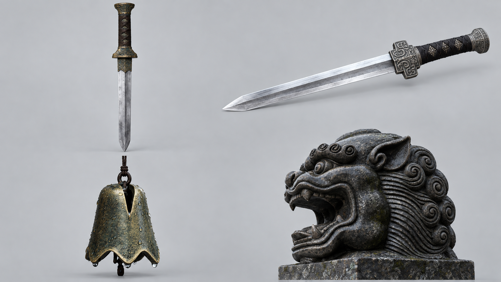

尺寸：1672×941像素，16:9整数像素近似。

Use case: product-mockup. One 16:9 landscape cinematic historical Chinese film prop design board, photorealistic materials. Neutral light grey background, FOUR isolated prop groups in a clear 2 by 2 grid, generous gaps, no people or human hands, no scenes, no text, no logos, no watermarks. Complete objects, no cell overlap. Match provided reference forms; unseen details can be conservatively completed. TOP LEFT: complete ancient Chinese straight double-edged sword standing vertically, weathered dark bronze decorated hilt shaped as in reference1, pale steel blade. TOP RIGHT: complete martial combat jian sword horizontally angled, polished broad straight double-edge blade, engraved grey metal symmetrical crossguard and dark wrap grip as reference2. BOTTOM LEFT: aged small bronze bell with scalloped flower-shaped bottom rim, high slit near top, suspended by thin dark cord, wet patina like reference3. BOTTOM RIGHT: dark grey stone lion/beast head with open mouth and curling carved mane exactly like reference4, mounted on short stone block; no hand or weapon inside mouth. Distinguish two sword types.

## PD02 灯具与炉火设定

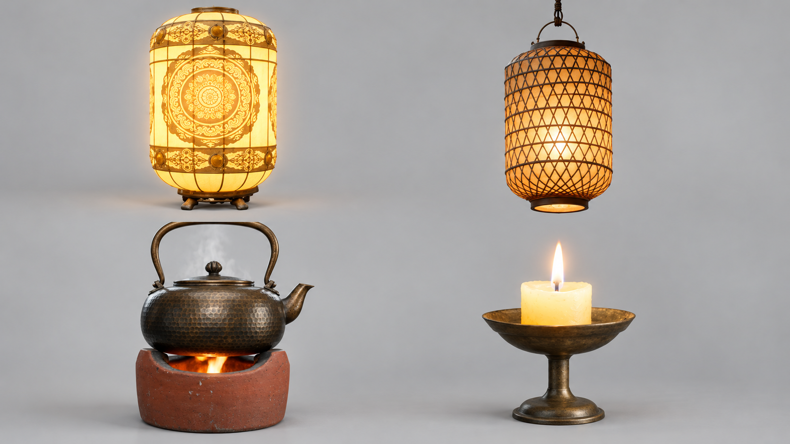

尺寸：1672×941像素，16:9整数像素近似。

Use case: product-mockup. One 16:9 landscape cinematic historical Chinese film prop design board, photorealistic materials. Neutral light grey background, FOUR isolated prop groups in a clear 2 by 2 grid, generous gaps, no people or human hands, no scenes, no text, no logos, no watermarks. Complete objects, no cell overlap. Match provided reference forms; unseen details can be conservatively completed. TOP LEFT: glowing ornate golden translucent cylindrical ritual lantern exactly like reference1, rounded top, embossed gold circular floral medallion on face, golden top and base bands, strong warm light internally but retain visible outline. TOP RIGHT: ordinary warm yellow cylindrical bamboo woven lantern exactly reference2, black/dark thin diamond mesh outer weave, hanging curved loop and dark rim, no red reinvention. BOTTOM LEFT: aged hammered bronze round kettle with lid, high arch handle and short spout on reddish clay charcoal stove with small orange flame, reference3. BOTTOM RIGHT: short ivory candle, flame, on shallow dark bronze saucer with slender stem, reference4. All separate, fully visible.
